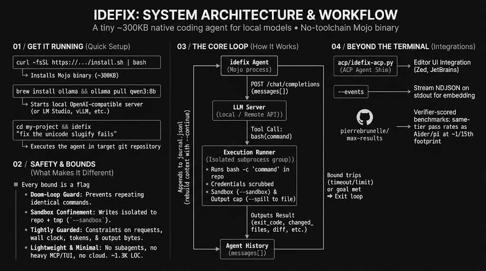

# idefix

**A small coding agent that runs on your own machine, with your own model.**

You give it a task in plain English. It works inside your project by running
shell commands, reading the results, and repeating until the task is done.
It talks to any local model server that speaks the OpenAI API (Ollama,
LM Studio, llama.cpp, vLLM, `max serve`), so nothing leaves your computer.

- One ~300 KB binary. No Python, no Node, no account.
- One tool: the model can only run `bash` commands in your repo.
- Every limit is a flag: requests, time, output size, tokens.
- About 1,300 lines of code you can read in an hour.



## Quick start

**1. Install** (macOS arm64 or Linux x86_64, prebuilt, no toolchain needed):

```bash
curl -fsSL https://github.com/pierrebrunelle/idefix/releases/latest/download/install.sh | bash
export PATH="$HOME/.local/bin:$PATH"
```

**2. Start a model server.** Ollama is the easiest:

```bash
brew install ollama && brew services start ollama   # macOS
ollama pull qwen3:8b
```

**3. Run it from inside your project:**

```bash
cd my-project
idefix "the slugify test fails on unicode input, fix it"
```

idefix finds a server on ports 11434 (Ollama), 8000 or 1234 (LM Studio) by
itself and uses the model that server has loaded. When it finishes you get
a one-line summary and the model's answer:

```text
[idefix] requests=4 commands=3 prompt_tokens=812 tokens=1982+71 elapsed=21s exit=0
Fixed: normalize accents before lowercasing in slugify().
```

## Ways to use it

| Command | What it does |
|---|---|
| `idefix "task"` | Do one task, then exit |
| `idefix` | Interactive chat. `/reset` clears context, `!cmd` runs a shell command, `/quit` exits |
| `cat todo.txt \| idefix` | Each line is a task, sharing one session |
| `idefix --continue` | Pick up this repo's last session where it stopped |
| `idefix edit FILE` | Apply SEARCH/REPLACE blocks from stdin to a file |

## Choosing a server and model

Set these when auto-detection picks the wrong thing:

```bash
export IDEFIX_BASE_URL=http://127.0.0.1:1234/v1   # any OpenAI-compatible server
export IDEFIX_MODEL=qwen3:8b                       # model id as the server names it
export IDEFIX_API_KEY=...                          # only if your server needs one
```

Or put the same values in `~/.idefix/config`, one per line:

```text
model=qwen3:8b
base_url=http://127.0.0.1:11434/v1
```

Tip: some `Qwen3-4B-Instruct` builds print tool calls as plain text instead
of real tool calls, so nothing runs. If idefix answers without running any
commands, try a different build or server.

## Limits and safety

idefix stops itself when any limit is hit and exits with code 2. Defaults:

| Flag | Default | Limits |
|---|---|---|
| `--max-requests N` | 40 | model calls per task |
| `--max-seconds N` | 1800 | total wall time |
| `--max-command-seconds N` | 120 | each shell command |
| `--max-output-bytes N` | 65536 | command output shown to the model |
| `--max-prompt-tokens N` | off | prompt size |

It also stops when the model repeats the same command three times in a
row (turn off with `--no-loop-guard`).

Commands run as **your user, inside your repo**. Environment variables
whose names look like secrets (`KEY`, `TOKEN`, `SECRET`, `PASSWORD`,
`CREDENTIAL`) are removed first. Add `--sandbox` to only allow writes
inside the repo and temp dirs. Use git so you can review and undo changes.

Run `idefix --help` for every flag.

## How it works

```text
            "fix the bug"
                 |
                 v
   +--->  ask the model, offering one tool: bash(command)
   |             |
   |             v
   |      did it ask to run a command? -- no --> print answer, exit 0
   |             | yes
   |             v
   |      run it in the repo (own process group, time limit,
   |      secrets removed, long output trimmed)
   |             |
   |             v
   |      send back: exit code, files changed, short diff
   |             |
   +-------------+      any limit hit -> exit 2
```

Every step is written to a journal under `~/.idefix`, which is how
`--continue` resumes a session.

## Use it in your editor

`acp/idefix-acp.py` lets Zed and JetBrains IDEs use idefix from their agent
panel. Setup takes one settings entry: see [acp/README.md](acp/README.md).

To build your own UI, `--events` streams each step as JSON lines on stdout.

## How well does it work?

All results are scored by running each task's real tests, never by the
agent's own report. The benchmark, the comparisons with aider, pi,
opencode, goose and others, and the raw logs are in
[pierrebrunelle/max-results](https://github.com/pierrebrunelle/max-results).

In short: on small local models (4B to 8B), idefix passes about as many
tasks as agents with many times more code. On hard tasks every agent fails at that size.
The model is the limit, and idefix is small enough that you can measure
that yourself.

## What it does not do

No TUI, no MCP, no cloud providers, no sub-agents, no long-term memory.
These were left out on purpose. If you need them, look at aider, pi or
Claude Code.

## Build from source

Needs [Mojo](https://docs.modular.com/mojo/) (`pip install modular`), a C
compiler and libcurl.

```bash
make            # builds ./idefix
make test       # runs the test suite against a stub server
./install.sh    # installs to ~/.local/bin/idefix
```

Contributor rules are in [AGENTS.md](AGENTS.md).

## License

[MIT](LICENSE)
