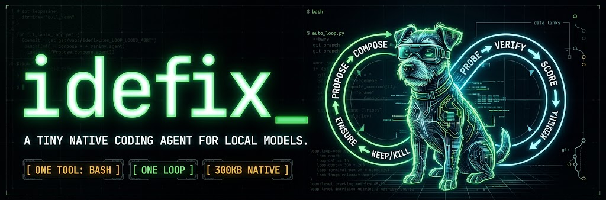

# idefix

**A tiny native coding agent for local models. One tool: `bash`. One loop.**

```bash
curl -fsSL https://github.com/pierrebrunelle/idefix/releases/latest/download/install.sh | bash
idefix "fix the parser bug and re-run the tests"
```

---

## What

`idefix` is a **~300 KB Mojo binary** that takes a task, talks to a local LLM over an OpenAI-compatible endpoint, runs the model's `bash(command)` calls inside your repo, and prints the answer. One file of agent code you can read in an hour.

- Zero Python at runtime, no dependencies beyond `libcurl`
- ~16 MB peak RSS (vs ~250 MB for Python harnesses)
- Works with `max serve` (Modular), Ollama, LM Studio, llama-server, vLLM — anything that speaks `/v1/chat/completions`

## Who it's for

- **You run local models** — Qwen3, Llama, anything on Ollama/MAX/LM Studio — and want a coding agent that treats them as the target, not a config hack.
- **You measure harness vs model.** `capability = model × harness`; a trustworthy measurement needs a harness you can actually read. This is one.
- **You want the smallest thing that works.** One loop, one tool, ~1.5k lines of agent logic, every bound enforced and tested.

**Not for you if** you want a TUI, MCP, hosted cloud providers, plugins, or sub-agents — that's [pi](https://github.com/earendil-works/pi), aider, or claude-code, and they're good.

## Why

> Agent capability = model × harness.
> The harness half should be small enough to hold in your head.

A bare Python loop already covers most trivial tasks. `idefix` is that loop plus the verified hardening a real repo deserves — bounded requests, honest tool results, journaling, sandbox, process cleanup — and nothing else. Features ship when they move a benchmark number, not when they sound useful.

Picking an agent, honestly:

| You want | Use |
|---|---|
| A polished TUI with providers, plugins, MCP | pi, aider, claude-code |
| A big framework to build your own agent | LangGraph, NeMo, Mastra |
| The smallest auditable loop for local models | **idefix** |

```text
USER  "fix the parser bug"   (one-shot | REPL | piped session)
  |
  v
HARNESS  idefix ~1.5k LOC -> 300KB native binary
  |  POST /v1/chat/completions  (+ tools[])
  v
SERVER  max serve - ollama - LM Studio - llama-server - vLLM
  |  message.tool_calls[bash(command)]
  v
MODEL   Qwen3-1.7B..14B — the intelligence; the harness only feeds it

EXECUTION  (inside idefix)
  tool_call -> fork+exec /bin/bash -c "cmd"
     ├─ process group; killpg on timeout/deadline
     ├─ env scrub: KEY/TOKEN/SECRET/PASSWORD/CREDENTIAL
     ├─ PATH gains `idefix edit`  (exact-match edits fail loud)
     └─ --sandbox: seatbelt, writes = repo + tmp only
            v
     filesystem (the repo)
        pre:  md5 snapshot + APFS clonefile
        post: changed_files + compact diff + no-op warning
            v
     tool result -> next model turn   (journal replays the session)
```

The full loop, state chart, and dataflow: [ARCHITECTURE.md](ARCHITECTURE.md).

## How

Three steps:

```bash
# 1. Get a model server once (Modular's CLI doubles as ours)
pip install modular        # or: pipx install modular

# 2. Install the agent — from the latest release (no toolchain needed)
curl -fsSL https://github.com/pierrebrunelle/idefix/releases/latest/download/install.sh | bash
idefix --version           # -> "idefix 0.x"

#    or build from source (needs mojo on PATH):
git clone https://github.com/pierrebrunelle/idefix.git && cd idefix && ./install.sh

# 3. Use it, from inside any project
cd my-project
idefix "the slugify test fails on unicode input - fix it and re-run the tests"
```

The first run lazily boots a local server (`Qwen/Qwen3-1.7B`, ~2 GB RAM), runs your task, and shuts it down. Already running one? The wrapper probes `ollama :11434`, `max serve :8000`, and `LM Studio :1234` — if any answers, `idefix` uses it with zero exports (adopting the loaded model where the server reports one).

Point at something specific, once:

```bash
export IDEFIX_BASE_URL=http://127.0.0.1:11434/v1   # e.g. ollama
export IDEFIX_MODEL=qwen3:4b
idefix "fix the parser bug and run its tests"
```

or persist it in `~/.idefix/config` (key=value lines; env vars override):

```text
base_url=http://127.0.0.1:11434/v1
model=hf.co/nvidia/NVIDIA-Nemotron-3.5-Bolt-E4B-4GB:Q4_K_M
```

```text
$ idefix --repo . "test_slugify fails on 'Creme Brulee'; fix it"
[model] Reading slugify and its test.
[model] lower() runs before the accent strip. Patching.
[model] Tests pass.
[idefix] requests=4 commands=3 prompt_tokens=812 tokens=1982+71 elapsed=21s exit=0
Fixed: normalize accents before lowercasing in slugify().
```

More:

```bash
printf 'fix the parser\nadd tests for it\n' | idefix   # piped session
idefix                                                # interactive REPL
idefix edit file.py <<'EOF'                           # structured edit
<<<<<<< SEARCH
old code
=======
new code
>>>>>>> REPLACE
EOF
```


## Where it runs

- **OS:** macOS (arm64) and Linux (x86_64) — `make` builds `./idefix`, `make bundle` ships binary + dylibs + wrapper.
- **Model server:** any OpenAI-compatible endpoint (`IDEFIX_BASE_URL`, `IDEFIX_MODEL`, `IDEFIX_API_KEY`; legacy `MAX_*` names still work). The wrapper boots Modular `max serve` on demand if nothing is answering.
- **Repo:** any directory via `--repo`; the REPL uses your cwd. `AGENTS.md` / `CLAUDE.md` at the root is loaded automatically.

## When to use it (and when not)

**Use it for:**

- One-shot and unattended runs — `--bare` strips guardrails for protocol parity, `--sandbox` confines writes, `--continue`/`--resume` replay or resume sessions.
- Measuring what a *model* can do — `--bare` is byte-parity with the reference client in `pierrebrunelle/max-results`.
- Small-model tasks where a 250 MB Python harness is overhead and a 1k-line audit target is the point.

**Don't reach for it when** you want polish over auditability: no TUI, no MCP, no remote cloud providers, no sub-agents. That's a feature — read `pi` or `aider` instead.

## Benchmarks

Every row is verified by the task's independent test script — never by the model's self-report (methodology in `pierrebrunelle/max-results`).

### 6-Task Suite (`Qwen3-4B`, 2 reps)

| Harness | Pass Rate | Peak RSS | Runtime Stack |
| :--- | :---: | :---: | :--- |
| `aider` | 100% | ~250 MB | Python |
| **`idefix --bare`** | **75%** | **~16 MB** | **Mojo (native)** |
| `pi` | 58% | — | — |

A hierarchical posterior over all scored runs (max-results `ANALYSIS.md`) says the honest version is: **same-tier pass rates as aider/pi at ~1/15th the footprint** — the gap between these rows is inside the noise at this sample size.

**Failure analysis** (`long-horizon`, `Qwen3-14B`): `aider` and `pi` pass, `idefix` went 0/4 — free-form `bash` let the model *think* an edit landed when it hadn't. The fix shipped in the harness: `changed_files` in every tool result, an explicit warning on no-op writes, and `idefix edit` for loud-failing structured edits. The remaining gap is model capability.

**Harder tasks** (`tree-directory-parser`, `analyze-access-logs`, `jsonl-aggregator` — Terminal-Bench): Qwen3-4B went **0/16 across idefix, pi, aider and dsh**, every harness producing a fabricated "verified" claim that never ran a check. Nemotron-E4B passed 2/4 on the same grid — read inputs first, self-corrected, zero fabrications. At 4B the binding constraint is the model, and it shows up identically in every harness.

## Scope & Limits

- One loop, one tool (`bash`), one file of agent logic.
- Commands run with your user permissions inside the repo path unless `--sandbox` is passed. Use an isolated checkout for untrusted tasks.
- Credential env vars (`KEY`, `TOKEN`, `SECRET`, `PASSWORD`, `CREDENTIAL`) are scrubbed from model-issued subshells.
- Non-goals on purpose: no streaming, no cloud providers, no MCP, no sub-agents. The model server is a separate OS process the binary never manages.

If you want a polished pair-programming UI or hosted APIs, use aider or pi. `idefix` is a laboratory for measuring how small the agent loop can get. How the loop works internally: [ARCHITECTURE.md](ARCHITECTURE.md).
