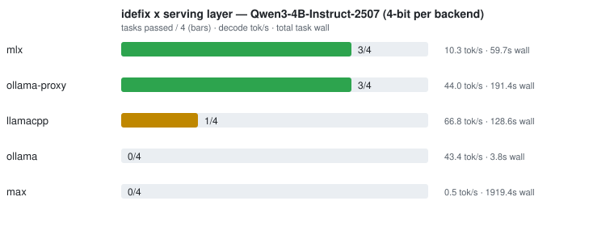

# idefix

**A tiny native coding agent for local models. One tool: `bash`. One loop.**

```bash
curl -fsSL https://github.com/pierrebrunelle/idefix/releases/latest/download/install.sh | bash
idefix "fix the parser bug and re-run the tests"
```

A ~300 KB Mojo binary, ~1.3k lines of agent logic you can read in an hour.
It takes a task, talks to any OpenAI-compatible server (`max serve`,
Ollama, LM Studio, llama-server, vLLM), runs the model's `bash(command)`
calls inside your repo, and prints the answer. Zero Python at runtime,
~16 MB peak RSS.

Capability = model × harness. The harness half should be small enough to
hold in your head — that is the whole reason idefix exists.

## Use

```bash
cd my-project
idefix "the slugify test fails on unicode input - fix it"
```

The first run lazily boots a local server (`Qwen/Qwen3-1.7B`) and shuts
it down after. Already serving? The wrapper probes `ollama :11434`,
`max serve :8000`, `LM Studio :1234` and adopts the loaded model —
zero exports needed. To pick one explicitly:

```bash
export IDEFIX_BASE_URL=http://127.0.0.1:11434/v1   # e.g. ollama
export IDEFIX_MODEL=qwen3:4b                      # or ~/.idefix/config
```

```text
$ idefix --repo . "test_slugify fails on 'Creme Brulee'; fix it"
[idefix] requests=4 commands=3 prompt_tokens=812 tokens=1982+71 elapsed=21s exit=0
Fixed: normalize accents before lowercasing in slugify().
```

```bash
printf 'fix the parser\nadd tests for it\n' | idefix   # piped session
idefix                                                # REPL (/reset, !cmd, /quit)
idefix edit file.py <<'EOF'                           # structured edit
<<<<<<< SEARCH
old code
=======
new code
>>>>>>> REPLACE
EOF
```

## What a command goes through

`bash -c` in the repo: own process group, killpg on timeout, env scrubbed
of `KEY`/`TOKEN`/`SECRET`/`PASSWORD`/`CREDENTIAL`. After each command the
model sees `changed_files`, a compact diff, and a warning when a
write-shaped command changed nothing — exit 0 with no diff is reported as
a warning, not success.

Every bound is a flag: `--max-requests --max-seconds
--max-command-seconds --max-output-bytes --max-http-bytes
--max-prompt-tokens --max-calls-per-response --retries --no-loop-guard
--doom-warn --compact-at --bare --sandbox --continue
--resume`. `--bare` strips the guardrails and is byte-parity with the
reference client; `--sandbox` confines writes to repo + tmp.

## Measured: one model, five serving layers

Same Mojo binary, same model (Qwen3-4B-Instruct-2507, 4-bit per backend),
same 4 verifier-scored coding tasks, 1 rep — directional, not statistical:



| serving layer | tasks passed | decode | total task wall |
|---|---|---|---|
| MLX-LM | 3/4 | 10 tok/s | 60s |
| Ollama + tool-call proxy | 3/4 | 44 tok/s | 191s |
| llama.cpp | 1/4 | 67 tok/s | 129s |
| Ollama native | 0/4 | 43 tok/s | protocol fail |
| `max serve` | 0/4 | 0.5 tok/s | wall-capped |

Two findings the raw numbers hide:

- "OpenAI-compatible" does not guarantee structured tool calls. Ollama's
  template for this model emits `<tool_call>` text inside a reasoning
  field; idefix executed zero commands until a ~100-line proxy rewrote
  it into `tool_calls`. That is a protocol failure, not a model failure.
- Fastest decode did not win. llama.cpp generated 6x faster than MLX
  but passed fewer tasks — the serving layer changes what the model
  effectively is (template, quant, tool format), not just its speed.

Data and methodology:
[pierrebrunelle/max-results](https://github.com/pierrebrunelle/max-results/tree/main/bench).

## Honest status

Benchmarks (verifier-scored, never self-reported; methodology in
[pierrebrunelle/max-results](https://github.com/pierrebrunelle/max-results)):
same-tier pass rates as aider and pi at ~1/15th the footprint. On hard
tasks every harness fails at 4B — the binding constraint is the model,
and idefix is built so you can measure exactly that.

No TUI, no MCP, no cloud providers, no sub-agents — that is pi, aider,
claude-code. Commands run as your user inside `--repo` unless
`--sandbox`. Internals: [ARCHITECTURE.md](ARCHITECTURE.md).
