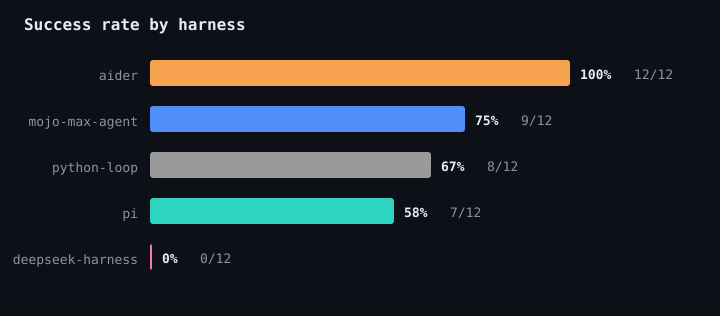
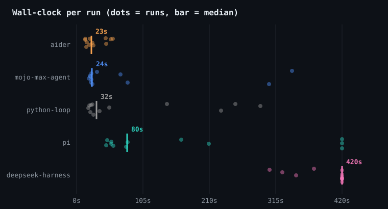
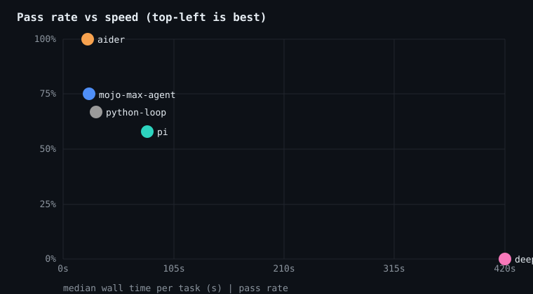
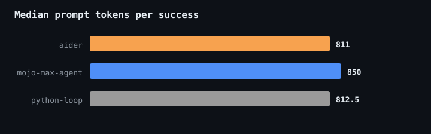

# Benchmark results

Model: `Qwen/Qwen3-4B-Instruct-2507` on MAX (local). 36 runs: 6 tasks x 2 reps x 3 harnesses.

## Leaderboard

| harness | pass rate | median wall | peak RSS | median tokens |
| --- | --- | --- | --- | --- |
| aider | 12/12 (100%) | 23.1s | 250.2 MB | 811.0 |
| mojo-max-agent | 9/12 (75%) | 24.5s | 15.8 MB | 933.5 |
| python-loop | 8/12 (67%) | 31.5s | 18.0 MB | 822 |

 

 

## Pass rate by task

| task | mojo-max-agent | python-loop | aider |
| --- | --- | --- | --- |
| empty-input | 100% | 100% | 100% |
| fix-add | 100% | 100% | 100% |
| multi-file | 100% | 100% | 100% |
| off-by-one | 100% | 100% | 100% |
| parse-config | 0% | 0% | 100% |
| slugify | 50% | 0% | 100% |

 

## Raw runs

| harness | task | rep | pass | requests | commands | tokens | wall_s | rss_mb | exit |
| --- | --- | --- | --- | --- | --- | --- | --- | --- | --- |
| mojo-max-agent | empty-input | 1 | 1 | 3 | 3 | 788 | 22.1 | 15.8 | 0 |
| python-loop | empty-input | 1 | 1 | 3 | 3 | 822 | 22.4 | 17.8 | 0 |
| mojo-max-agent | empty-input | 2 | 1 | 3 | 3 | 812 | 22.3 | 15.9 | 0 |
| python-loop | empty-input | 2 | 1 | 3 | 3 | 828 | 25.2 | 18.2 | 0 |
| mojo-max-agent | fix-add | 1 | 1 | 6 | 5 | 1052 | 32.4 | 15.8 | 0 |
| python-loop | fix-add | 1 | 1 | 8 | 7 | 1465 | 51.8 | 17.9 | 0 |
| mojo-max-agent | fix-add | 2 | 1 | 4 | 5 | 980 | 23.3 | 16.1 | 0 |
| python-loop | fix-add | 2 | 1 | 4 | 3 | 801 | 26.4 | 18.1 | 0 |
| mojo-max-agent | multi-file | 1 | 1 | 5 | 4 | 850 | 23.7 | 15.8 | 0 |
| python-loop | multi-file | 1 | 1 | 4 | 3 | 768 | 20.1 | 17.8 | 0 |
| mojo-max-agent | multi-file | 2 | 1 | 5 | 4 | 887 | 25.3 | 15.8 | 0 |
| python-loop | multi-file | 2 | 1 | 6 | 5 | 1115 | 36.6 | 18.3 | 0 |
| mojo-max-agent | off-by-one | 1 | 1 | 3 | 3 | 720 | 19.5 | 16.0 | 0 |
| python-loop | off-by-one | 1 | 1 | 4 | 3 | 803 | 21.6 | 18.0 | 0 |
| mojo-max-agent | off-by-one | 2 | 1 | 3 | 2 | 665 | 21.1 | 15.8 | 0 |
| python-loop | off-by-one | 2 | 1 | 4 | 3 | 764 | 18.8 | 18.0 | 0 |
| mojo-max-agent | parse-config | 1 | 0 | 15 | 14 | 5803 | 304.5 | 15.8 | 0 |
| python-loop | parse-config | 1 | 0 | 12 | 11 | 4674 | 229.0 | 17.7 | 0 |
| mojo-max-agent | parse-config | 2 | 0 | 15 | 15 | 6446 | 341.3 | 16.2 | 2 |
| python-loop | parse-config | 2 | 0 | None | None | None | 143.0 | 18.0 | 1 |
| mojo-max-agent | slugify | 1 | 0 | 5 | 4 | 1102 | 80.8 | 15.8 | 0 |
| python-loop | slugify | 1 | 0 | None | None | None | 251.5 | 18.0 | 2 |
| mojo-max-agent | slugify | 2 | 1 | 5 | 4 | 1101 | 69.5 | 15.8 | 0 |
| python-loop | slugify | 2 | 0 | None | None | None | 290.9 | 17.8 | 2 |
| aider | empty-input | 1 | 1 | 1 | None | 794 | 15.8 | 238.2 | 0 |
| aider | empty-input | 2 | 1 | 1 | None | 794 | 13.5 | 259.6 | 0 |
| aider | fix-add | 1 | 1 | 1 | None | 777 | 15.6 | 245.5 | 0 |
| aider | fix-add | 2 | 1 | 1 | None | 777 | 13.5 | 249.4 | 0 |
| aider | multi-file | 1 | 1 | 1 | None | 849 | 26.4 | 251.0 | 0 |
| aider | multi-file | 2 | 1 | 1 | None | 849 | 24.9 | 252.1 | 0 |
| aider | off-by-one | 1 | 1 | 1 | None | 807 | 21.4 | 248.8 | 0 |
| aider | off-by-one | 2 | 1 | 1 | None | 807 | 19.9 | 257.5 | 0 |
| aider | parse-config | 1 | 1 | 1 | None | 892 | 46.3 | 260.2 | 0 |
| aider | parse-config | 2 | 1 | 1 | None | 892 | 47.0 | 243.9 | 0 |
| aider | slugify | 1 | 1 | 1 | None | 815 | 57.4 | 253.4 | 0 |
| aider | slugify | 2 | 1 | 1 | None | 815 | 54.3 | 244.0 | 0 |
