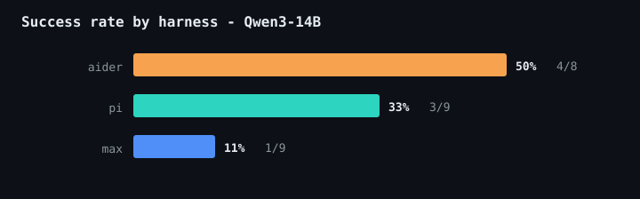
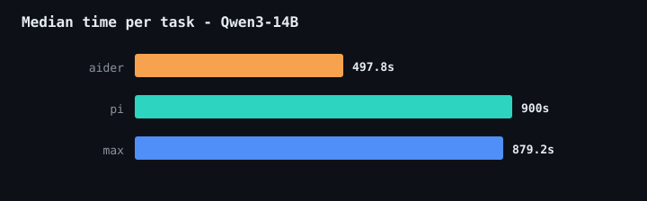
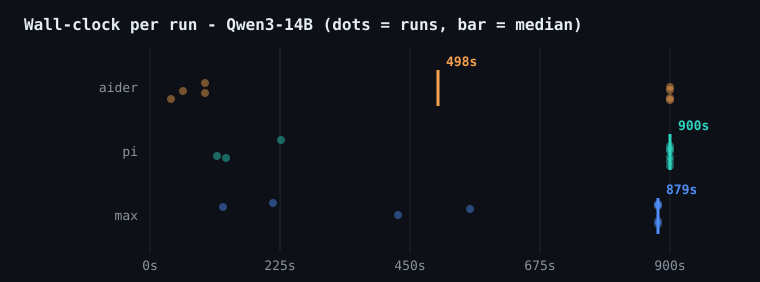
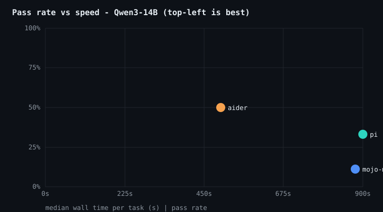
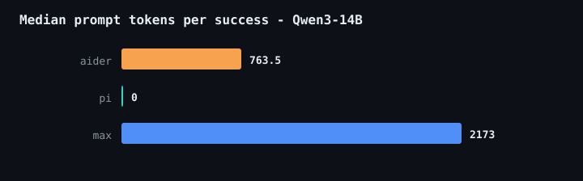
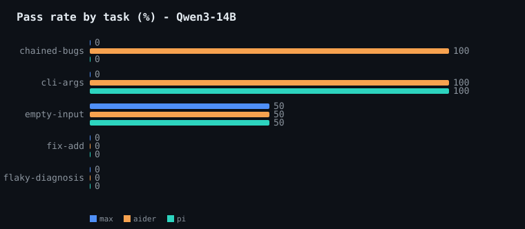
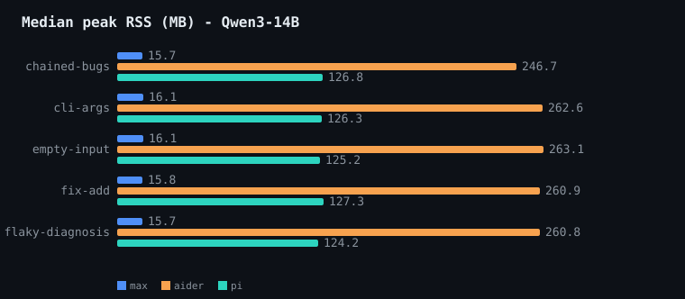

# Benchmark results

Local MAX serving (`max serve`, single replica). Harness versions:
pi 1.3.0, deepseek-harness 0.2.0-rc.2, aider 0.86.2. Verified by each
task's independent `verify.sh`; tokens are usage-reported, not scored.

## `Qwen/Qwen3-4B-Instruct-2507`

60 valid runs (60 total): 6 tasks x 2 reps x 5 harnesses.

## Leaderboard

| harness | pass rate | median wall | peak RSS | median tokens |
| --- | --- | --- | --- | --- |
| aider | 12/12 (100%) | 23.1s | 250.2 MB | 811.0 |
| max | 9/12 (75%) | 24.5s | 15.8 MB | 933.5 |
| python-loop | 8/12 (67%) | 31.5s | 18.0 MB | 822 |
| pi | 7/12 (58%) | 79.8s | 125.9 MB | 2750.0 |
| deepseek-harness | 0/12 (0%) | 420.3s | 191.9 MB | None |

 

 

### Methodology notes

- max and python-loop talk to MAX on :8000 with a text-command
  protocol; aider uses its edit-format prompts on :8000. pi and
  deepseek-harness use native OpenAI tool calling, which this MAX serve
  build cannot parse (no hermes tool parser), so they run through
  bench/toolcall_proxy.py on :8001, which rewrites <tool_call> text into
  structured tool_calls. Wall times include the proxy hop.
- deepseek-harness rows: the model reads the ~6k-token Cordis plugin system
  prompt and may generate refusal-style text instead of tool calls; such
  runs die at the 420s watchdog inside a single completion. A 0% here is a
  model x harness interaction, not a verdict on dsh on bigger models.
- Timeout rows count in medians; 'requests=None' means the run was killed
  before its first LLM call returned.

### Pass rate by task

| task | max | python-loop | aider | pi | deepseek-harness |
| --- | --- | --- | --- | --- | --- |
| empty-input | 100% | 100% | 100% | 100% | 0% |
| fix-add | 100% | 100% | 100% | 100% | 0% |
| multi-file | 100% | 100% | 100% | 100% | 0% |
| off-by-one | 100% | 100% | 100% | 50% | 0% |
| parse-config | 0% | 0% | 100% | 0% | 0% |
| slugify | 50% | 0% | 100% | 0% | 0% |

 

### Raw runs

| harness | task | rep | pass | requests | commands | tokens | wall_s | rss_mb | exit |
| --- | --- | --- | --- | --- | --- | --- | --- | --- | --- |
| max | empty-input | 1 | 1 | 3 | 3 | 788 | 22.1 | 15.8 | 0 |
| python-loop | empty-input | 1 | 1 | 3 | 3 | 822 | 22.4 | 17.8 | 0 |
| max | empty-input | 2 | 1 | 3 | 3 | 812 | 22.3 | 15.9 | 0 |
| python-loop | empty-input | 2 | 1 | 3 | 3 | 828 | 25.2 | 18.2 | 0 |
| max | fix-add | 1 | 1 | 6 | 5 | 1052 | 32.4 | 15.8 | 0 |
| python-loop | fix-add | 1 | 1 | 8 | 7 | 1465 | 51.8 | 17.9 | 0 |
| max | fix-add | 2 | 1 | 4 | 5 | 980 | 23.3 | 16.1 | 0 |
| python-loop | fix-add | 2 | 1 | 4 | 3 | 801 | 26.4 | 18.1 | 0 |
| max | multi-file | 1 | 1 | 5 | 4 | 850 | 23.7 | 15.8 | 0 |
| python-loop | multi-file | 1 | 1 | 4 | 3 | 768 | 20.1 | 17.8 | 0 |
| max | multi-file | 2 | 1 | 5 | 4 | 887 | 25.3 | 15.8 | 0 |
| python-loop | multi-file | 2 | 1 | 6 | 5 | 1115 | 36.6 | 18.3 | 0 |
| max | off-by-one | 1 | 1 | 3 | 3 | 720 | 19.5 | 16.0 | 0 |
| python-loop | off-by-one | 1 | 1 | 4 | 3 | 803 | 21.6 | 18.0 | 0 |
| max | off-by-one | 2 | 1 | 3 | 2 | 665 | 21.1 | 15.8 | 0 |
| python-loop | off-by-one | 2 | 1 | 4 | 3 | 764 | 18.8 | 18.0 | 0 |
| max | parse-config | 1 | 0 | 15 | 14 | 5803 | 304.5 | 15.8 | 0 |
| python-loop | parse-config | 1 | 0 | 12 | 11 | 4674 | 229.0 | 17.7 | 0 |
| max | parse-config | 2 | 0 | 15 | 15 | 6446 | 341.3 | 16.2 | 2 |
| python-loop | parse-config | 2 | 0 | None | None | None | 143.0 | 18.0 | 1 |
| max | slugify | 1 | 0 | 5 | 4 | 1102 | 80.8 | 15.8 | 0 |
| python-loop | slugify | 1 | 0 | None | None | None | 251.5 | 18.0 | 2 |
| max | slugify | 2 | 1 | 5 | 4 | 1101 | 69.5 | 15.8 | 0 |
| python-loop | slugify | 2 | 0 | None | None | None | 290.9 | 17.8 | 2 |
| aider | empty-input | 1 | 1 | 1 | None | 794 | 15.8 | 238.2 | 0 |
| aider | empty-input | 2 | 1 | 1 | None | 794 | 13.5 | 259.6 | 0 |
| aider | fix-add | 1 | 1 | 1 | None | 777 | 15.6 | 245.5 | 0 |
| aider | fix-add | 2 | 1 | 1 | None | 777 | 13.5 | 249.4 | 0 |
| aider | multi-file | 1 | 1 | 1 | None | 849 | 26.4 | 251.0 | 0 |
| aider | multi-file | 2 | 1 | 1 | None | 849 | 24.9 | 252.1 | 0 |
| aider | off-by-one | 1 | 1 | 1 | None | 807 | 21.4 | 248.8 | 0 |
| aider | off-by-one | 2 | 1 | 1 | None | 807 | 19.9 | 257.5 | 0 |
| aider | parse-config | 1 | 1 | 1 | None | 892 | 46.3 | 260.2 | 0 |
| aider | parse-config | 2 | 1 | 1 | None | 892 | 47.0 | 243.9 | 0 |
| aider | slugify | 1 | 1 | 1 | None | 815 | 57.4 | 253.4 | 0 |
| aider | slugify | 2 | 1 | 1 | None | 815 | 54.3 | 244.0 | 0 |
| pi | empty-input | 1 | 1 | 5 | 2 | 2769 | 46.8 | 127.3 | 0 |
| deepseek-harness | empty-input | 1 | 0 | None | None | None | 420.5 | 193.8 | 0 |
| pi | empty-input | 2 | 1 | 5 | 2 | 2770 | 54.8 | 128.8 | 0 |
| deepseek-harness | empty-input | 2 | 0 | 1 | None | None | 326.1 | 191.5 | 0 |
| pi | fix-add | 1 | 1 | 4 | 1 | 2568 | 48.4 | 125.8 | 0 |
| deepseek-harness | fix-add | 1 | 0 | None | None | None | 420.3 | 185.0 | 0 |
| pi | fix-add | 2 | 1 | 4 | 1 | 2566 | 54.7 | 126.3 | 0 |
| deepseek-harness | fix-add | 2 | 0 | 1 | None | None | 305.3 | 192.0 | 0 |
| pi | multi-file | 1 | 1 | 5 | 2 | 2731 | 80.7 | 127.2 | 0 |
| deepseek-harness | multi-file | 1 | 0 | None | None | None | 420.3 | 191.9 | 0 |
| pi | multi-file | 2 | 1 | 8 | 5 | 2874 | 165.4 | 115.4 | 0 |
| deepseek-harness | multi-file | 2 | 0 | None | None | None | 420.5 | 187.9 | 0 |
| pi | off-by-one | 1 | 1 | 4 | 1 | 2585 | 78.8 | 127.0 | 0 |
| deepseek-harness | off-by-one | 1 | 0 | None | None | None | 420.5 | 191.8 | 0 |
| pi | off-by-one | 2 | 0 | 2 | 1 | 2455 | 58.5 | 114.5 | 0 |
| deepseek-harness | off-by-one | 2 | 0 | 1 | None | None | 347.5 | 186.6 | 0 |
| pi | parse-config | 1 | 0 | 4 | 2 | 2970 | 420.4 | 126.0 | 143 |
| deepseek-harness | parse-config | 1 | 0 | 1 | None | None | 376.1 | 192.9 | 0 |
| pi | parse-config | 2 | 0 | 4 | 1 | 2901 | 209.5 | 109.9 | 0 |
| deepseek-harness | parse-config | 2 | 0 | None | None | None | 420.5 | 191.6 | 0 |
| pi | slugify | 1 | 0 | 1 | None | None | 420.1 | 124.6 | 143 |
| deepseek-harness | slugify | 1 | 0 | None | None | None | 420.3 | 192.8 | 0 |
| pi | slugify | 2 | 0 | 1 | None | None | 420.2 | 113.6 | 143 |
| deepseek-harness | slugify | 2 | 0 | None | None | None | 420.4 | 194.2 | 0 |

## `Qwen/Qwen3-14B`

26 valid runs (84 total): 5 tasks x 2 reps x 3 harnesses.
**58 runs excluded: their logs end on a transport/endpoint error (server outage), not a task outcome.**

## Leaderboard

| harness | pass rate | median wall | peak RSS | median tokens |
| --- | --- | --- | --- | --- |
| aider | 4/8 (50%) | 497.8s | 261.0 MB | 763.5 |
| pi | 3/9 (33%) | 900.0s | 126.7 MB | 0 |
| max | 1/9 (11%) | 879.2s | 15.8 MB | 737 |

 

 

### Methodology notes

- max and python-loop talk to MAX on :8000 with a text-command
  protocol; aider uses its edit-format prompts on :8000. pi and
  deepseek-harness use native OpenAI tool calling, which this MAX serve
  build cannot parse (no hermes tool parser), so they run through
  bench/toolcall_proxy.py on :8001, which rewrites <tool_call> text into
  structured tool_calls. Wall times include the proxy hop.
- Timeout rows count in medians; 'requests=None' means the run was killed
  before its first LLM call returned.

### Pass rate by task

| task | max | aider | pi |
| --- | --- | --- | --- |
| chained-bugs | 0% | 100% | 0% |
| cli-args | 0% | 100% | 100% |
| empty-input | 50% | 50% | 50% |
| fix-add | 0% | 0% | 0% |
| flaky-diagnosis | 0% | 0% | 0% |

 

### Raw runs

| harness | task | rep | pass | requests | commands | tokens | wall_s | rss_mb | exit |
| --- | --- | --- | --- | --- | --- | --- | --- | --- | --- |
| max | chained-bugs | 1 | 0 | 9 | 18 | 2704 | 879.2 | 15.7 | 3 |
| aider | chained-bugs | 1 | 1 | 1 | None | 862 | 35.7 | 246.7 | 0 |
| pi | chained-bugs | 1 | 0 | 24 | 24 | 6256 | 900.1 | 126.8 | 143 |
| max | chained-bugs | 2 | 0 | 6 | 6 | 1221 | 220.0 | 15.7 | 3 infra |
| aider | chained-bugs | 2 | 0 | None | None | None | 78.0 | 261.1 | 0 infra |
| pi | chained-bugs | 2 | 0 | 11 | 10 | 0 | 900.1 | 126.7 | 143 |
| max | cli-args | 1 | 0 | 5 | 6 | 2506 | 213.6 | 16.1 | 0 |
| aider | cli-args | 1 | 1 | 1 | None | 733 | 94.8 | 264.1 | 0 |
| pi | cli-args | 1 | 1 | 7 | 4 | 0 | 227.6 | 127.0 | 0 |
| max | cli-args | 2 | 0 | 12 | 21 | 2518 | 428.9 | 16.0 | 0 |
| aider | cli-args | 2 | 1 | 1 | None | 733 | 95.6 | 261.0 | 0 |
| pi | cli-args | 2 | 1 | 4 | 1 | 0 | 131.8 | 125.7 | 0 |
| max | empty-input | 1 | 0 | 4 | 3 | 737 | 126.0 | 16.2 | 0 |
| aider | empty-input | 1 | 1 | 1 | None | 794 | 56.4 | 265.0 | 0 |
| pi | empty-input | 1 | 1 | 5 | 2 | 0 | 115.2 | 124.7 | 0 |
| max | empty-input | 2 | 1 | 9 | 17 | 2173 | 879.5 | 16.1 | 3 |
| aider | empty-input | 2 | 0 | None | None | None | 900.1 | 261.2 | 143 |
| pi | empty-input | 2 | 0 | 2 | None | None | 900.0 | 125.7 | 143 |
| max | fix-add | 1 | 0 | 1 | 0 | 0 | 880.1 | 15.7 | 3 |
| aider | fix-add | 1 | 0 | None | None | None | 900.0 | 261.0 | 143 |
| pi | fix-add | 1 | 0 | 2 | None | None | 900.0 | 127.0 | 143 |
| max | fix-add | 2 | 0 | 1 | 0 | 0 | 880.1 | 15.8 | 3 |
| aider | fix-add | 2 | 0 | None | None | None | 900.1 | 260.9 | 143 |
| pi | fix-add | 2 | 0 | 2 | None | None | 900.1 | 127.7 | 143 |
| max | flaky-diagnosis | 1 | 0 | 1 | 0 | 0 | 880.1 | 15.7 | 3 |
| aider | flaky-diagnosis | 1 | 0 | None | None | None | 900.1 | 260.8 | 143 |
| pi | flaky-diagnosis | 1 | 0 | 2 | None | None | 900.1 | 124.2 | 143 |
| max | flaky-diagnosis | 2 | 0 | 1 | 0 | 0 | 553.5 | 15.7 | 3 |
| aider | flaky-diagnosis | 2 | 0 | None | None | None | 80.9 | 246.1 | 0 infra |
| pi | flaky-diagnosis | 2 | 0 | 4 | None | None | 14.4 | 128.9 | 0 infra |
| max | multi-file | 1 | 0 | 1 | 0 | 0 | 0.1 | 15.9 | 3 infra |
| aider | multi-file | 1 | 0 | None | None | None | 77.5 | 266.6 | 0 infra |
| pi | multi-file | 1 | 0 | 4 | None | None | 14.3 | 125.9 | 0 infra |
| max | multi-file | 2 | 0 | 1 | 0 | 0 | 0.1 | 15.9 | 3 infra |
| aider | multi-file | 2 | 0 | None | None | None | 77.5 | 266.3 | 0 infra |
| pi | multi-file | 2 | 0 | 4 | None | None | 14.3 | 126.6 | 0 infra |
| max | new-file-spec | 1 | 0 | 1 | 0 | 0 | 0.1 | 15.8 | 3 infra |
| aider | new-file-spec | 1 | 0 | None | None | None | 77.4 | 266.2 | 0 infra |
| pi | new-file-spec | 1 | 0 | 4 | None | None | 14.3 | 126.0 | 0 infra |
| max | new-file-spec | 2 | 0 | 1 | 0 | 0 | 0.1 | 15.8 | 3 infra |
| aider | new-file-spec | 2 | 0 | None | None | None | 76.9 | 266.2 | 0 infra |
| pi | new-file-spec | 2 | 0 | 4 | None | None | 14.3 | 125.7 | 0 infra |
| max | off-by-one | 1 | 0 | 1 | 0 | 0 | 0.1 | 15.9 | 3 infra |
| aider | off-by-one | 1 | 0 | None | None | None | 78.1 | 268.9 | 0 infra |
| pi | off-by-one | 1 | 0 | 4 | None | None | 14.3 | 126.0 | 0 infra |
| max | off-by-one | 2 | 0 | 1 | 0 | 0 | 0.1 | 15.9 | 3 infra |
| aider | off-by-one | 2 | 0 | None | None | None | 77.6 | 266.6 | 0 infra |
| pi | off-by-one | 2 | 0 | 4 | None | None | 14.2 | 126.3 | 0 infra |
| max | parse-config | 1 | 0 | 1 | 0 | 0 | 0.1 | 15.9 | 3 infra |
| aider | parse-config | 1 | 0 | None | None | None | 78.7 | 269.4 | 0 infra |
| pi | parse-config | 1 | 0 | 4 | None | None | 14.3 | 126.5 | 0 infra |
| max | parse-config | 2 | 0 | 1 | 0 | 0 | 0.1 | 15.8 | 3 infra |
| aider | parse-config | 2 | 0 | None | None | None | 78.0 | 266.7 | 0 infra |
| pi | parse-config | 2 | 0 | 4 | None | None | 14.3 | 126.1 | 0 infra |
| max | perf-bound | 1 | 0 | 1 | 0 | 0 | 0.1 | 15.9 | 3 infra |
| aider | perf-bound | 1 | 0 | None | None | None | 77.7 | 270.4 | 0 infra |
| pi | perf-bound | 1 | 0 | 4 | None | None | 14.3 | 126.3 | 0 infra |
| max | perf-bound | 2 | 0 | 1 | 0 | 0 | 0.1 | 15.9 | 3 infra |
| aider | perf-bound | 2 | 0 | None | None | None | 77.3 | 266.6 | 0 infra |
| pi | perf-bound | 2 | 0 | 4 | None | None | 14.3 | 126.3 | 0 infra |
| max | refactor-regress | 1 | 0 | 1 | 0 | 0 | 0.1 | 15.9 | 3 infra |
| aider | refactor-regress | 1 | 0 | None | None | None | 77.7 | 266.6 | 0 infra |
| pi | refactor-regress | 1 | 0 | 4 | None | None | 14.3 | 125.3 | 0 infra |
| max | refactor-regress | 2 | 0 | 1 | 0 | 0 | 0.1 | 15.9 | 3 infra |
| aider | refactor-regress | 2 | 0 | None | None | None | 77.4 | 266.7 | 0 infra |
| pi | refactor-regress | 2 | 0 | 4 | None | None | 14.3 | 125.9 | 0 infra |
| max | runtime-output | 1 | 0 | 1 | 0 | 0 | 0.1 | 15.9 | 3 infra |
| aider | runtime-output | 1 | 0 | None | None | None | 77.9 | 265.7 | 0 infra |
| pi | runtime-output | 1 | 0 | 4 | None | None | 14.3 | 126.0 | 0 infra |
| max | runtime-output | 2 | 0 | 1 | 0 | 0 | 0.1 | 15.9 | 3 infra |
| aider | runtime-output | 2 | 0 | None | None | None | 78.7 | 268.9 | 0 infra |
| pi | runtime-output | 2 | 0 | 4 | None | None | 14.3 | 126.0 | 0 infra |
| max | slugify | 1 | 0 | 1 | 0 | 0 | 0.1 | 15.9 | 3 infra |
| aider | slugify | 1 | 0 | None | None | None | 77.3 | 265.8 | 0 infra |
| pi | slugify | 1 | 0 | 4 | None | None | 14.3 | 126.9 | 0 infra |
| max | slugify | 2 | 0 | 1 | 0 | 0 | 0.1 | 15.9 | 3 infra |
| aider | slugify | 2 | 0 | None | None | None | 77.4 | 266.8 | 0 infra |
| pi | slugify | 2 | 0 | 4 | None | None | 14.3 | 126.7 | 0 infra |
| max | test-tamper-trap | 1 | 0 | 1 | 0 | 0 | 0.1 | 15.9 | 3 infra |
| aider | test-tamper-trap | 1 | 0 | None | None | None | 77.8 | 268.6 | 0 infra |
| pi | test-tamper-trap | 1 | 0 | 4 | None | None | 14.2 | 125.9 | 0 infra |
| max | test-tamper-trap | 2 | 0 | 1 | 0 | 0 | 0.1 | 15.9 | 3 infra |
| aider | test-tamper-trap | 2 | 0 | None | None | None | 77.9 | 268.4 | 0 infra |
| pi | test-tamper-trap | 2 | 0 | 4 | None | None | 14.3 | 125.8 | 0 infra |

