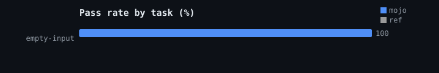
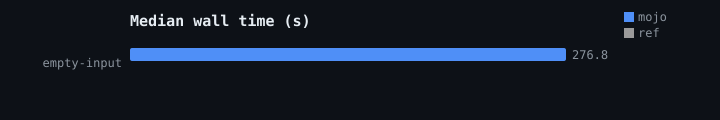
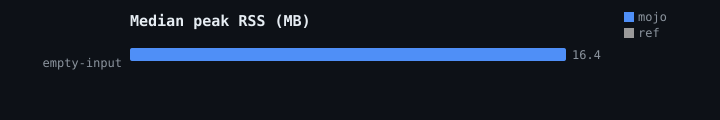
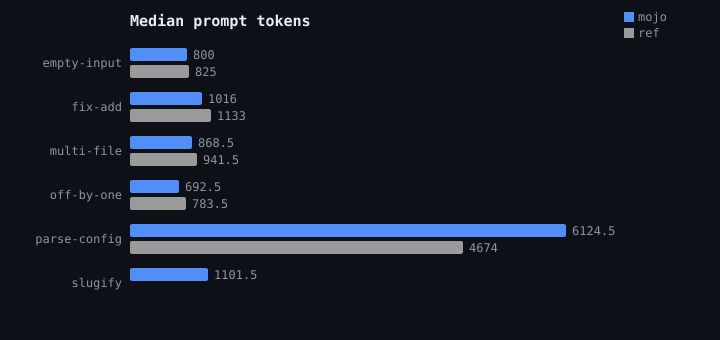

# Benchmark results

Model: `Qwen/Qwen3-1.7B` on MAX (CPU, float32). 1 runs: 1 tasks x 0 reps x 2 clients.

## Pass rate

| task | mojo | ref |
| --- | --- | --- |
| empty-input | 100% | -% |
| **overall** | **100%** | **-%** |

## Cost per run (median)

| metric | mojo | ref |
| --- | --- | --- |
| wall_s | 276.8 | None |
| peak RSS MB | 16.4 | None |
| prompt tokens | 646 | None |
| requests | 3 | None |
| commands | 3 | None |

  

## Raw runs

| client | task | rep | pass | requests | commands | tokens | wall_s | rss_mb | exit |
| --- | --- | --- | --- | --- | --- | --- | --- | --- | --- |
| mojo | empty-input | 1 | 1 | 3 | 3 | 646 | 276.8 | 16.4 | 0 |
